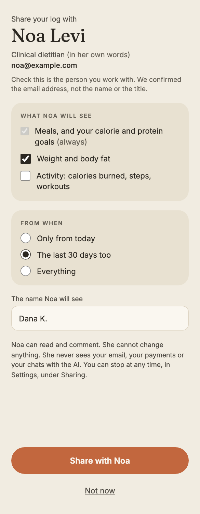
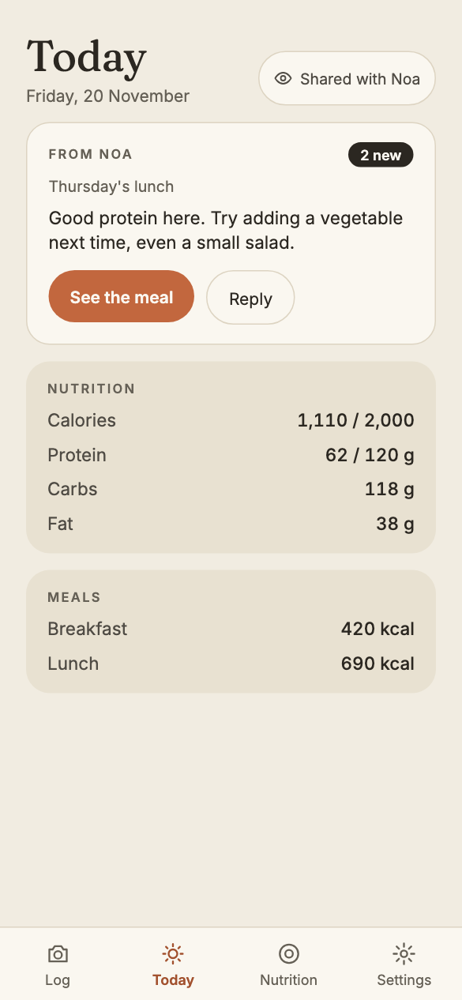
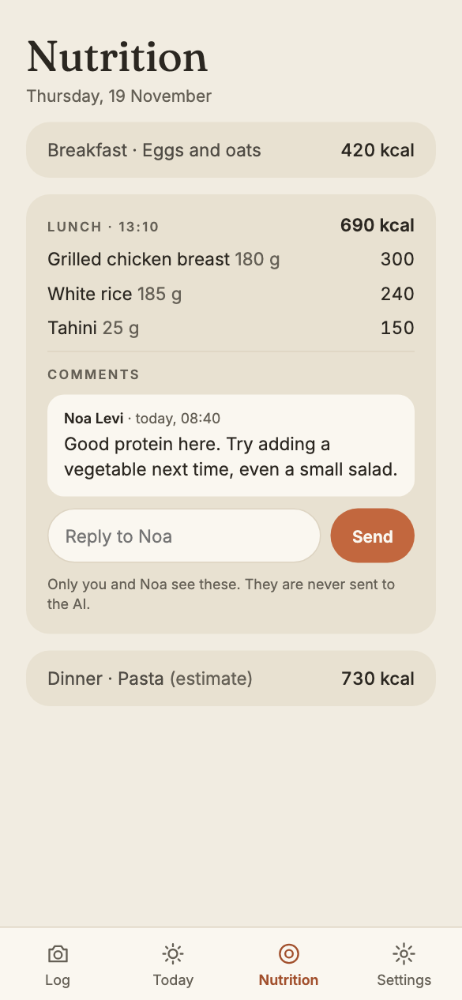
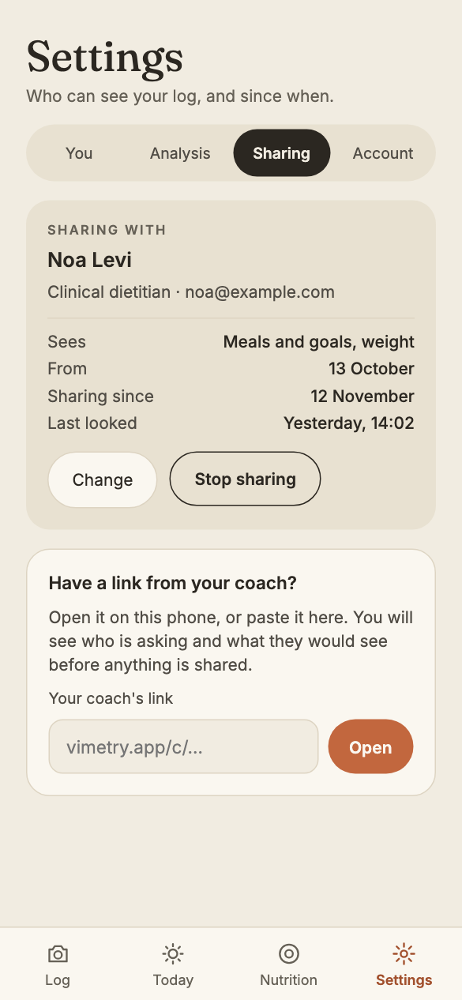
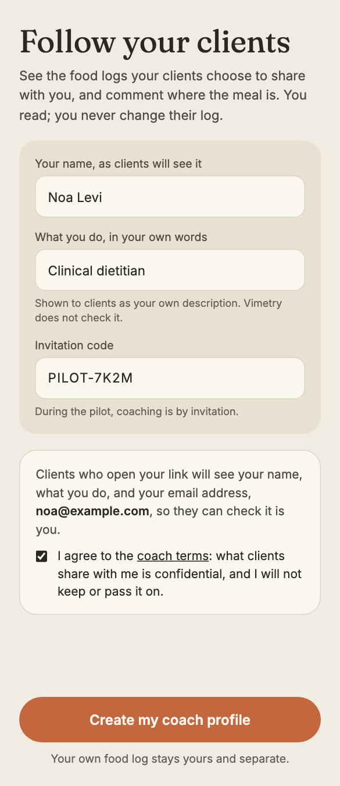
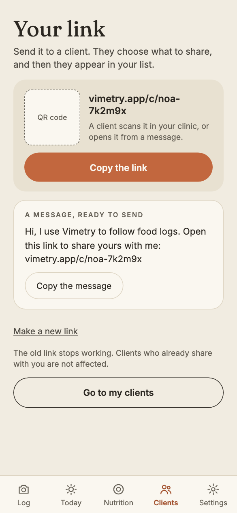
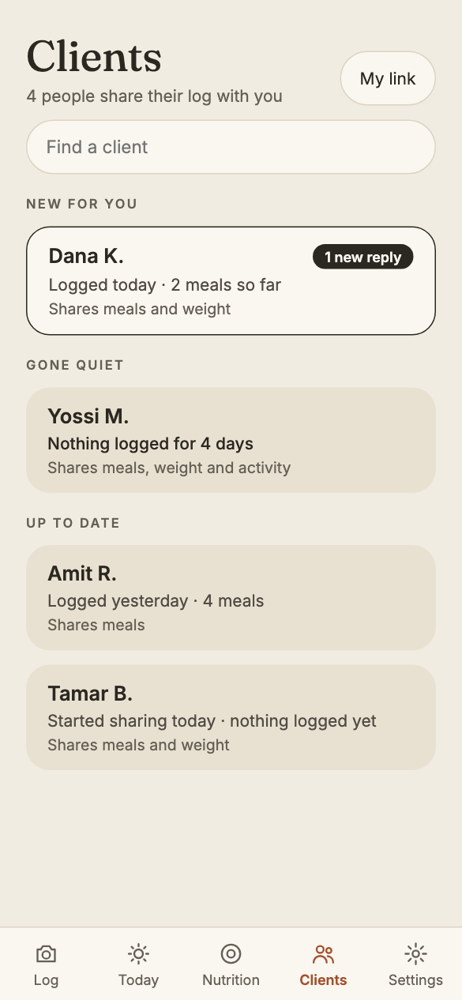
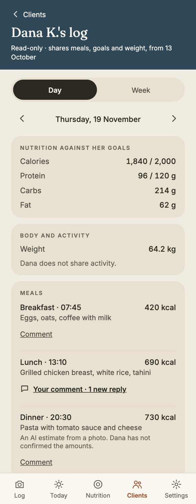
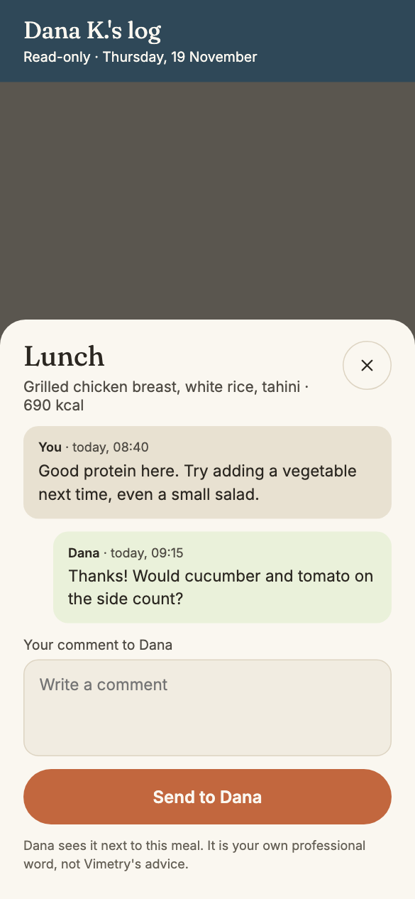

# Mock-ups — Coaches and nutritionists

The design for [`coaches.md`](../../coaches.md). Designed 2026-11-16; set aside by the owner, not built.

- **Interactive canvas** (private to the owner, on claude.ai): https://claude.ai/artifact/1Ba2VS3BPSDRR1yQTyd3vM
- **Below:** each screen as an image, rendered from the canvas on 2026-11-17.
- **`source/`:** the canvas files themselves (`*.dc.html`, `canvas.json`). They open only
  inside the claude.ai design canvas, which supplies their runtime; the images are the
  way to read them anywhere else.

The mock-ups are the design, not the product: where the built app differs, the app and
its spec are what count.

## 1 · Client: agree to share

## 2 · Client: Today, with a new comment

## 3 · Client: the comment on the meal

## 4 · Client: Settings, Sharing

## 5 · Coach: becoming a coach

## 6 · Coach: the link to send

## 7 · Coach: the client list

## 8 · Coach: a client's day, read-only

## 9 · Coach: writing a comment

