# Mock-ups — daily targets

The design for [`daily-targets.md`](../../daily-targets.md). Built 2026-11-21.

These are the **screens as built**, taken from the app on a phone (Pixel 7)
with the sample account. The design was worked out in the spec's "UX" section
and refined against these screens, so there is no separate canvas for this
feature. The sample person is on target today, so the "left" state shows in
the past-day screen as "under".

## 1 · Today: on target

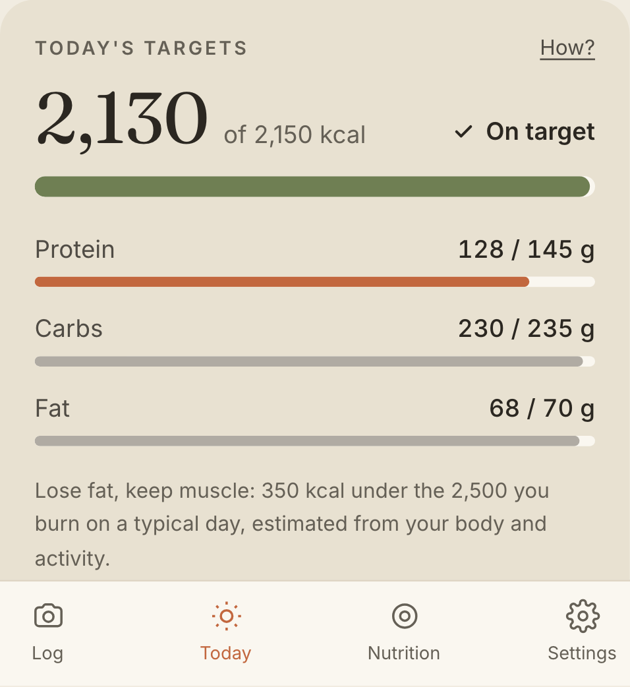

## 2 · A past day: what it came to

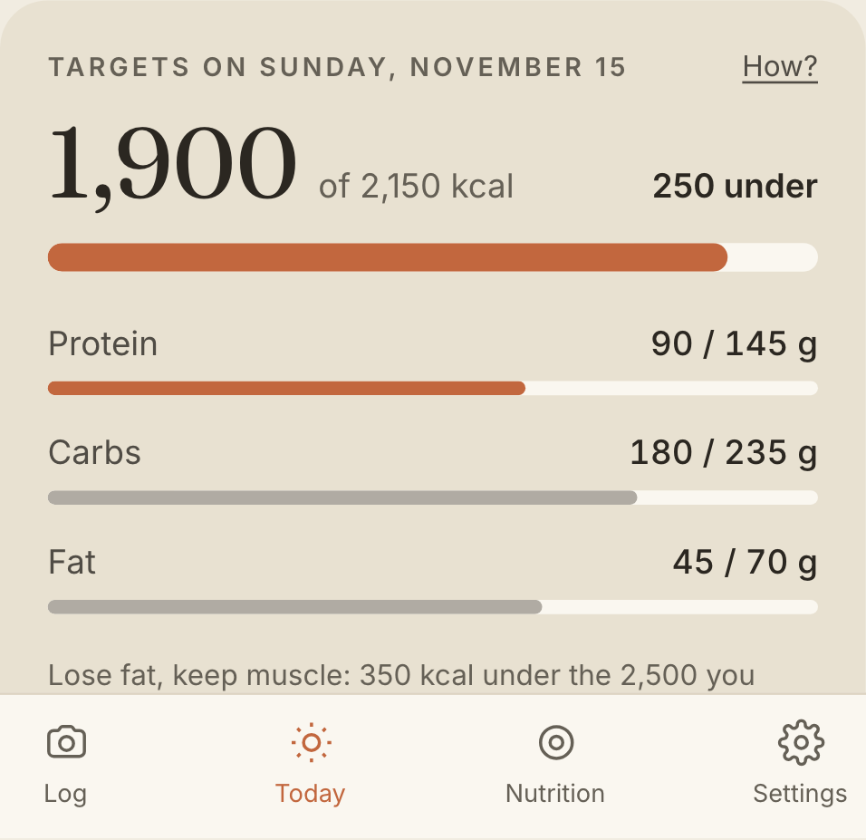

## 3 · Before the targets can be worked out: a checklist

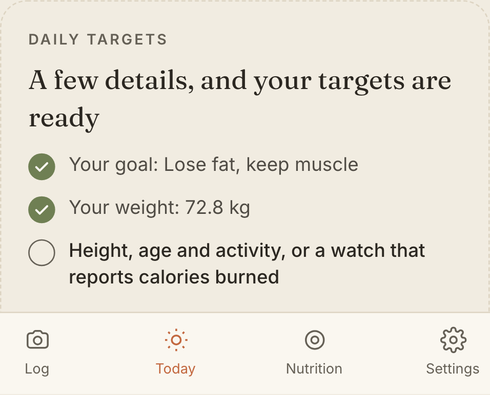

## 4 · The Nutrition tab: each total against its target

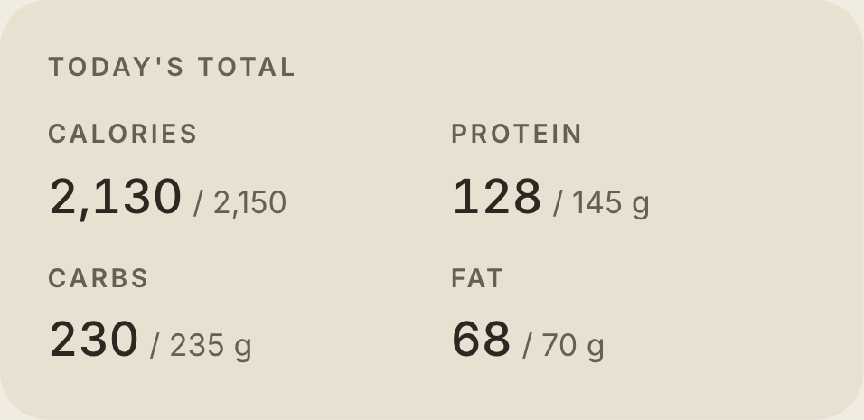

## 5 · Settings: about you

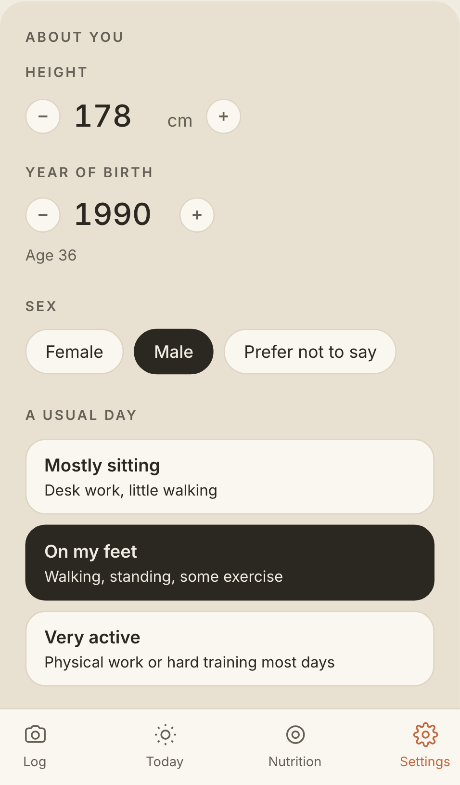

## 6 · Settings: the working behind every number

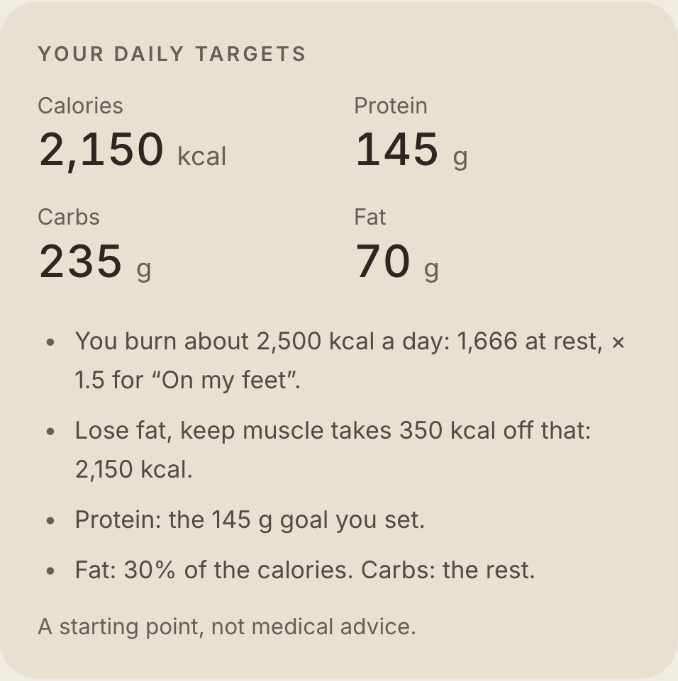

## 7 · עברית: היעדים של היום

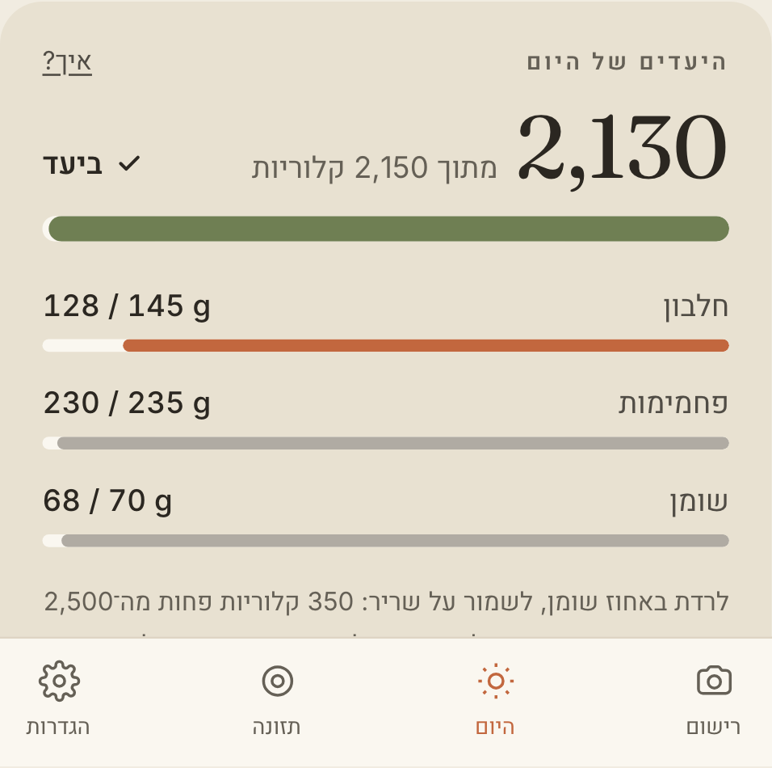

## 8 · עברית: היעדים היומיים שלכם

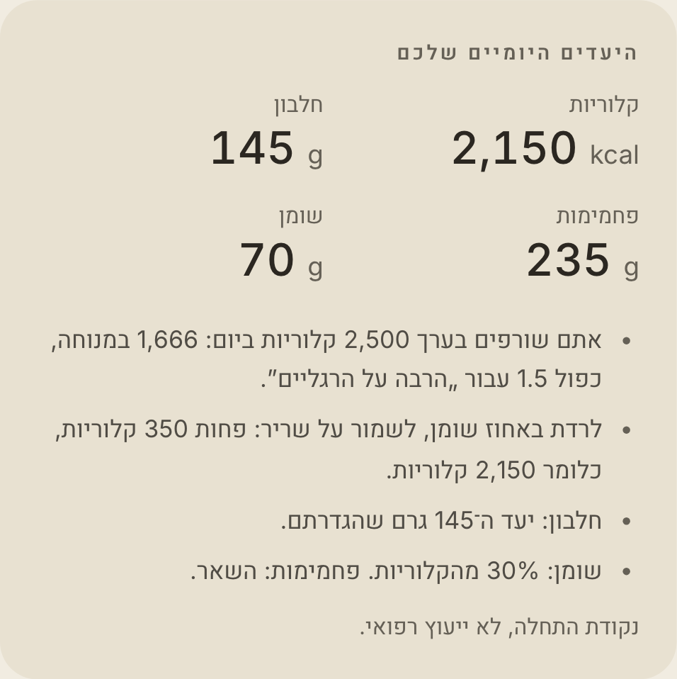

## 9 · עברית: רשימת הפרטים החסרים

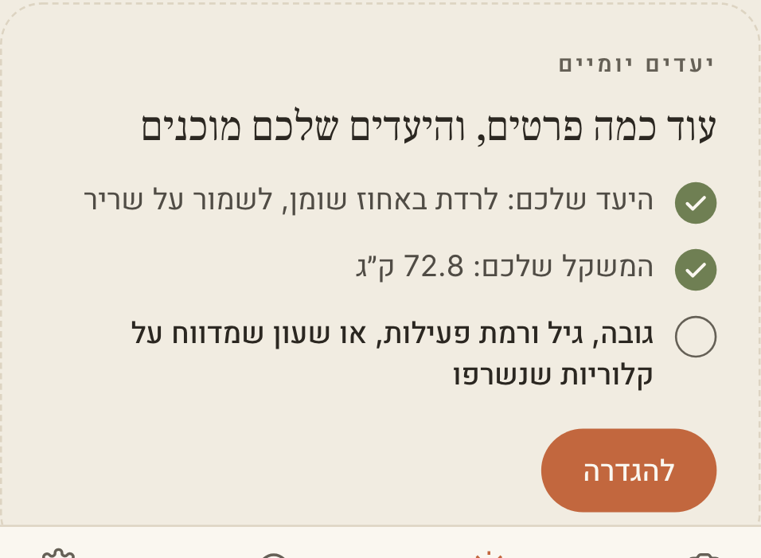

## 10 · Today: a streak

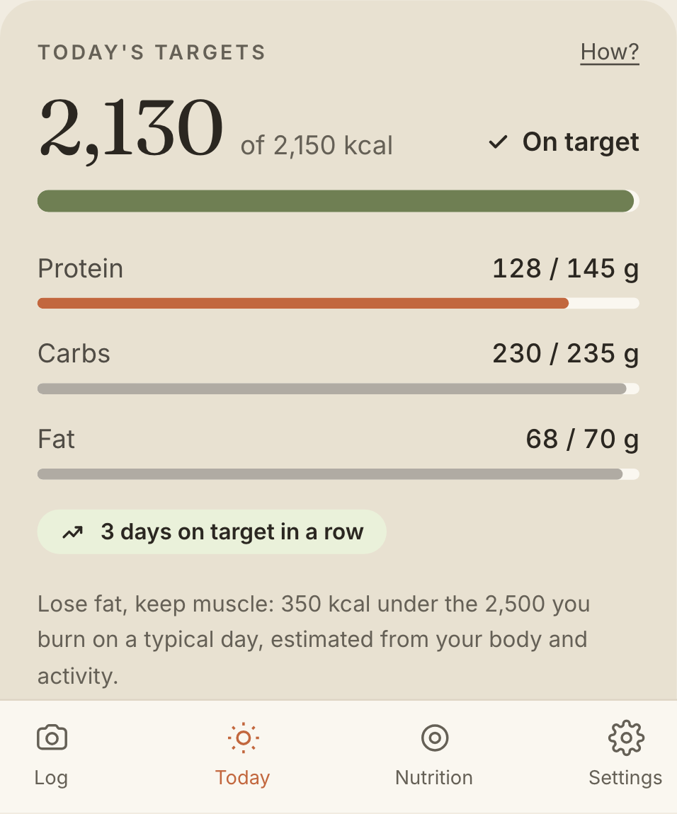

## 11 · The week view: targets this week

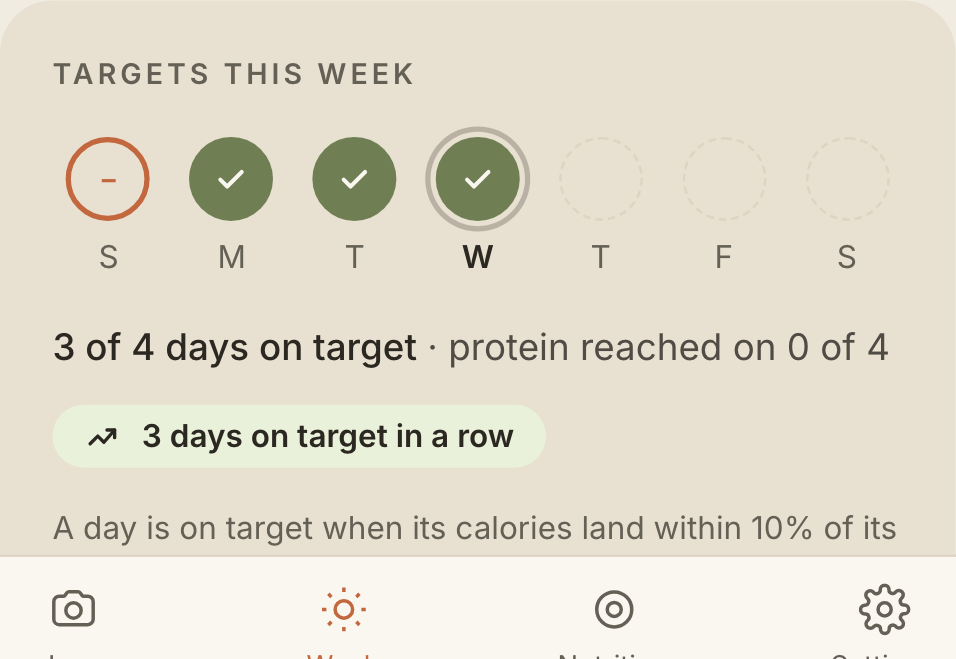

## 12 · Settings: your own numbers

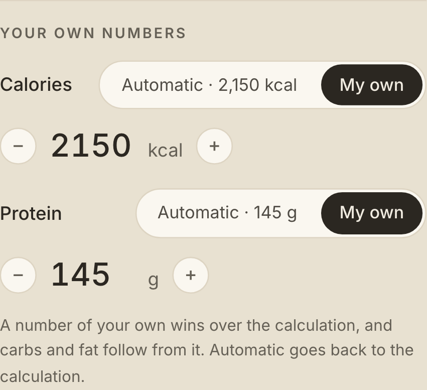

## 13 · עברית: היעדים השבוע

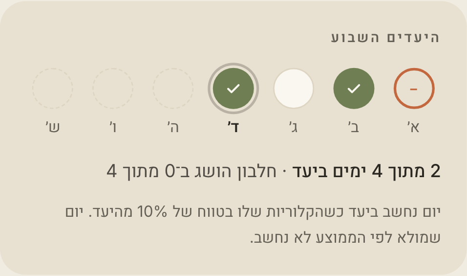
