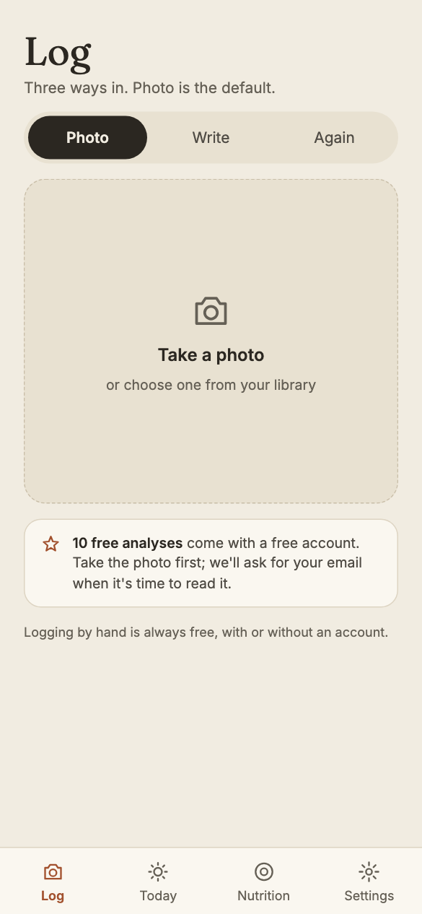
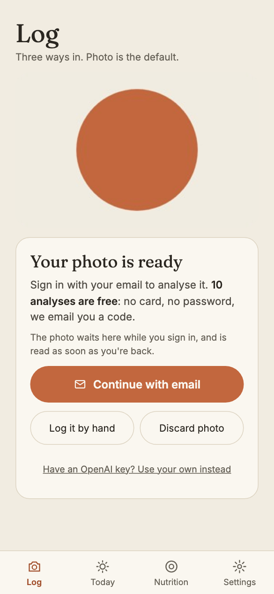
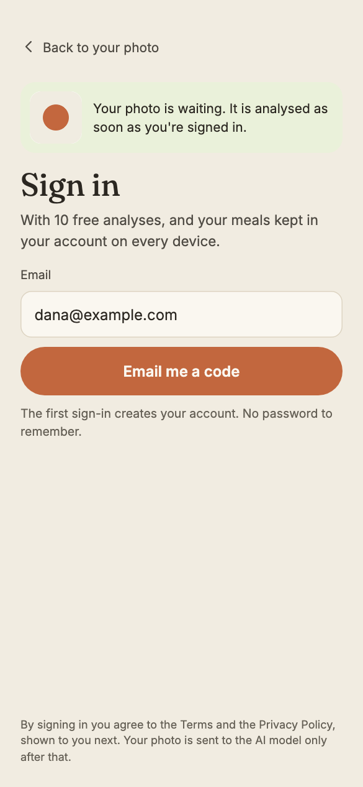
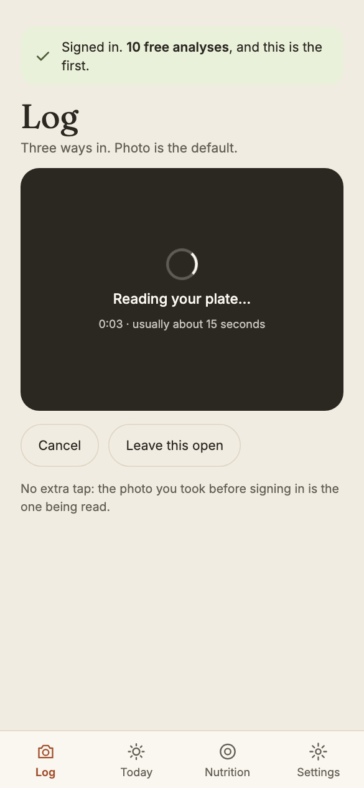
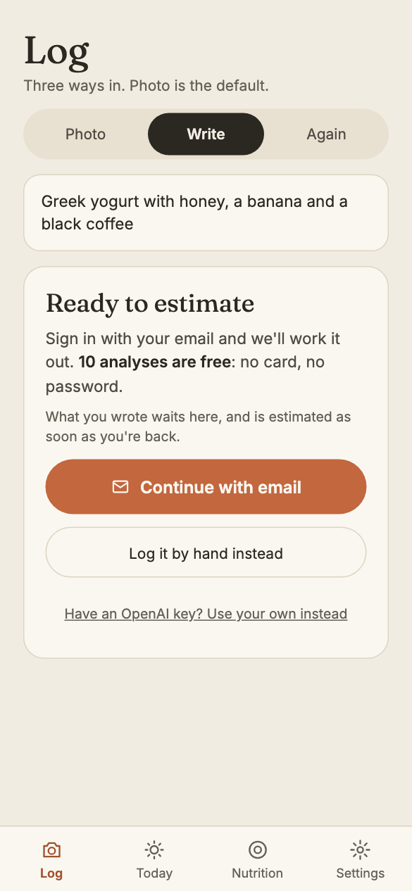
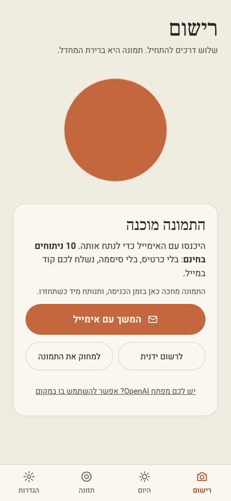
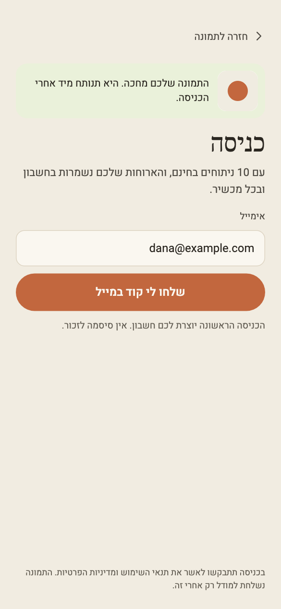
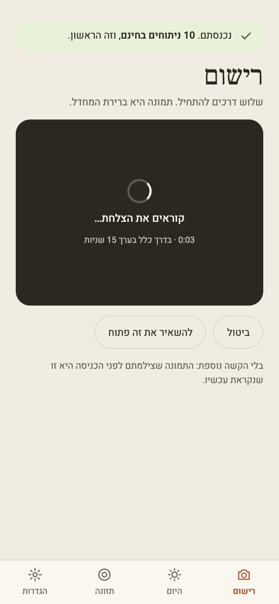

# Mock-ups — A new visitor's first photo

The design for [`first-photo.md`](../../first-photo.md). Built 2026-11-17.

- **Interactive canvas** (private to the owner, on claude.ai): https://claude.ai/artifact/VA8zXqXYQkyTc37HjuZEe4
- **Below:** each screen as an image, rendered from the canvas on 2026-11-17.
- **`source/`:** the canvas files themselves (`*.dc.html`, `canvas.json`). They open only
  inside the claude.ai design canvas, which supplies their runtime; the images are the
  way to read them anywhere else.

The mock-ups are the design, not the product: where the built app differs, the app and
its spec are what count.

## 1 · Before: the camera says what it needs

## 2 · The photo is ready: sign in to analyse it

## 3 · Sign in, with the photo waiting

## 4 · Back: it analyses by itself

## 5 · The same for a meal in words

## 6 · עברית: התמונה מוכנה

## 7 · עברית: כניסה, התמונה מחכה

## 8 · עברית: חזרה, הניתוח מתחיל

