# Mock-ups — what to eat now

For [`../../meal-suggestions.md`](../../meal-suggestions.md). Drawn 2026-11-26
as HTML in the app's colours and fonts (`source/make.py` writes the pages,
`source/shoot.mjs` renders them at 390 px); not an interactive canvas.

| | |
| --- | --- |
|  **1. Ask** — the line under Today's targets, and the button | 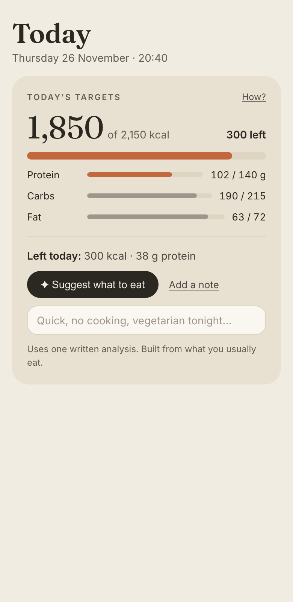 **2. With a note** — "quick, no cooking…" |
|  **3. Thinking** |  **4. Three suggestions**, best fit first |
| 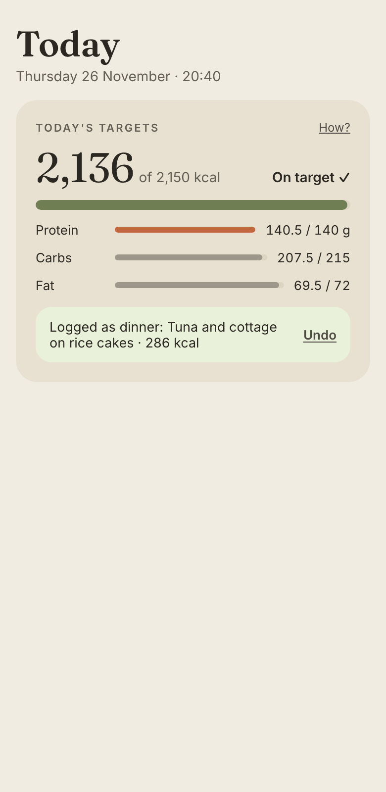 **5. Logged**, the targets move, Undo | 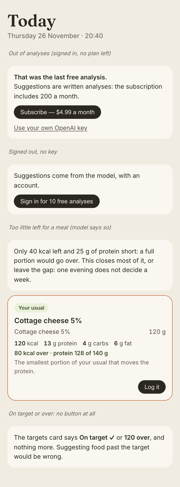 **8. Other states** |
| 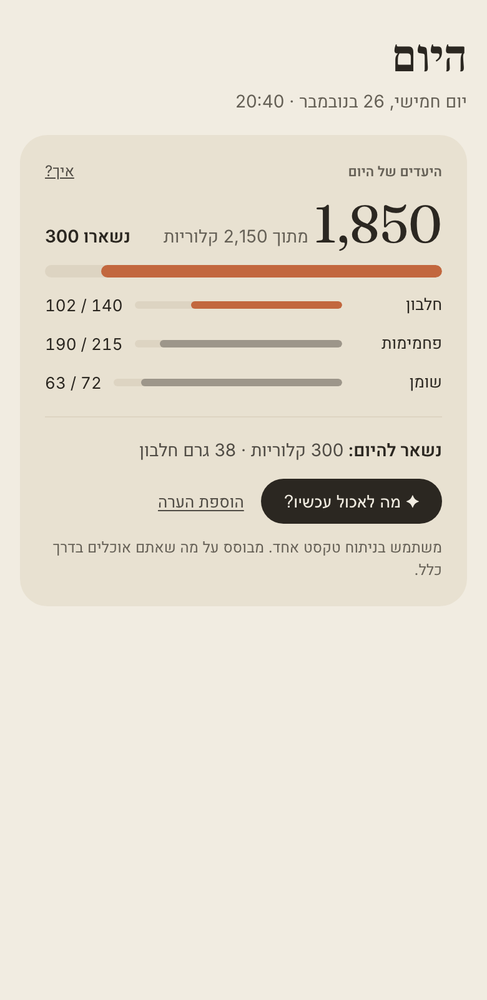 **6. Hebrew, ask** |  **7. Hebrew, suggestions** |

**As built** (2026-11-26), on the sample day: on target for calories, 17 g of
protein short, so the suggestions are small. The test model's answers, not a
real model's. Each suggestion also has **Take a photo** (the owner's addition).

| | |
| --- | --- |
|  **9. Ask** |  **10. Suggestions** |
|  **11. Hebrew, ask** | 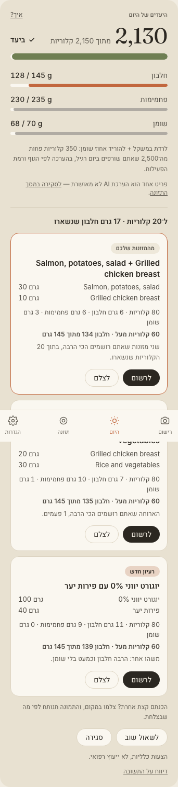 **12. Hebrew, suggestions** |

**Second round** (2026-11-26): over today but short of protein, the week
decides. Drawn first:

| | |
| --- | --- |
|  **13. Room in the week: a protein snack** | 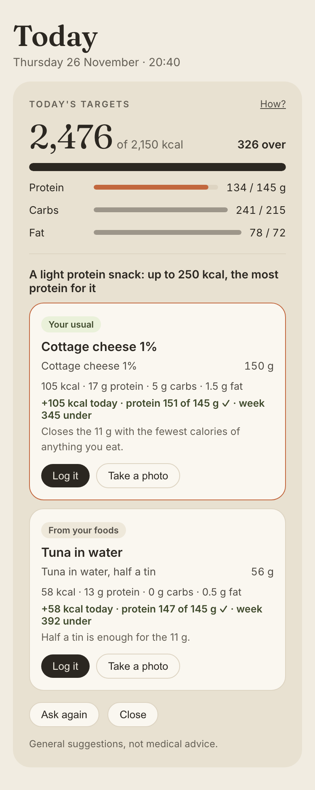 **14. The protein snacks** |
|  **15. No room: better to stop** |  **16. Hebrew, protein snack** |
| 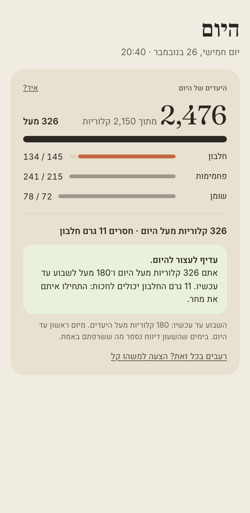 **17. Hebrew, stop** | |

And as built, on the sample day (20 kcal left, 17 g of protein short, the
week 190 under), then with a 1,200 kcal dinner added:

| | |
| --- | --- |
| 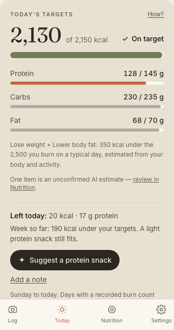 **18. Protein snack** | 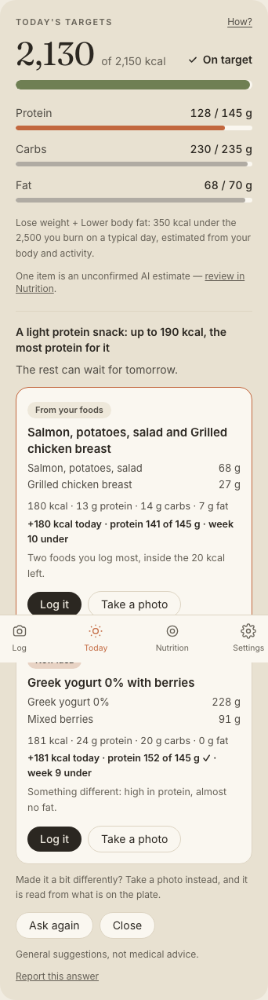 **19. The snacks**, up to 190 kcal |
| 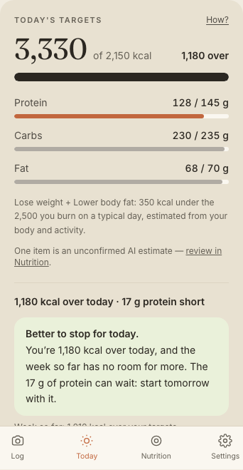 **20. Stop** |  **21. Hebrew, stop** |

**Third round, drawn** (2026-11-26): the week's protein, fat and carbs, and
what else should shape a suggestion.

| | |
| --- | --- |
| 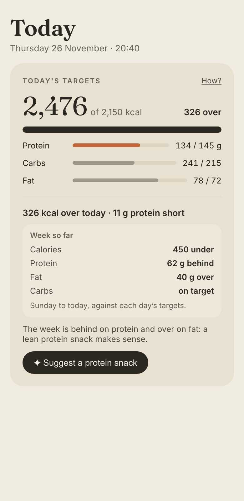 **22. The week's macros** decide with the calories | 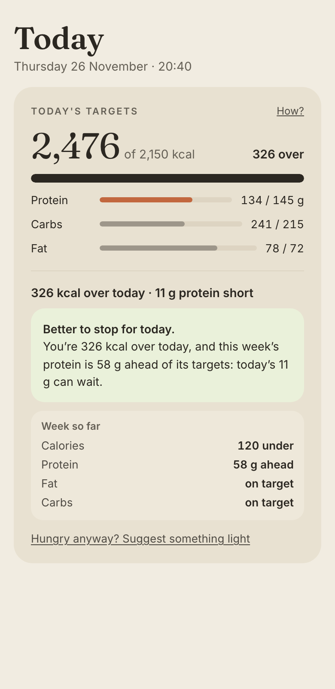 **23. Protein ahead for the week**: stop |
| 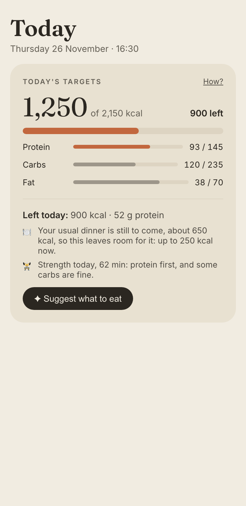 **24. Room kept for the usual dinner, and today's training** | 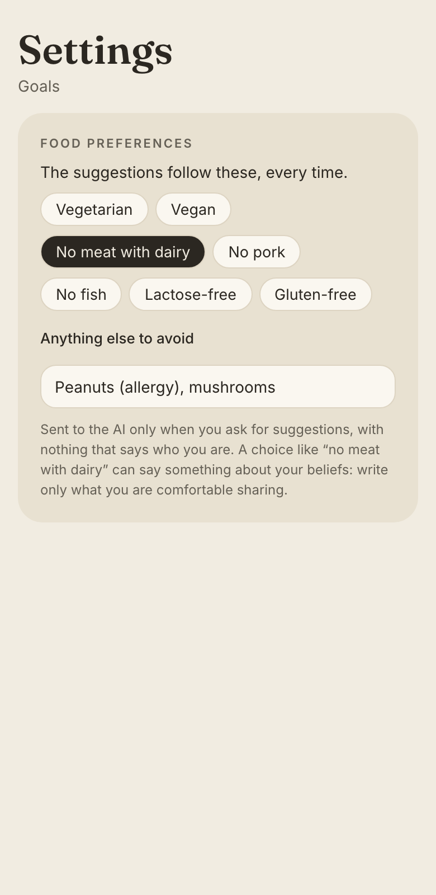 **25. Food preferences**, in Settings → Goals |
| 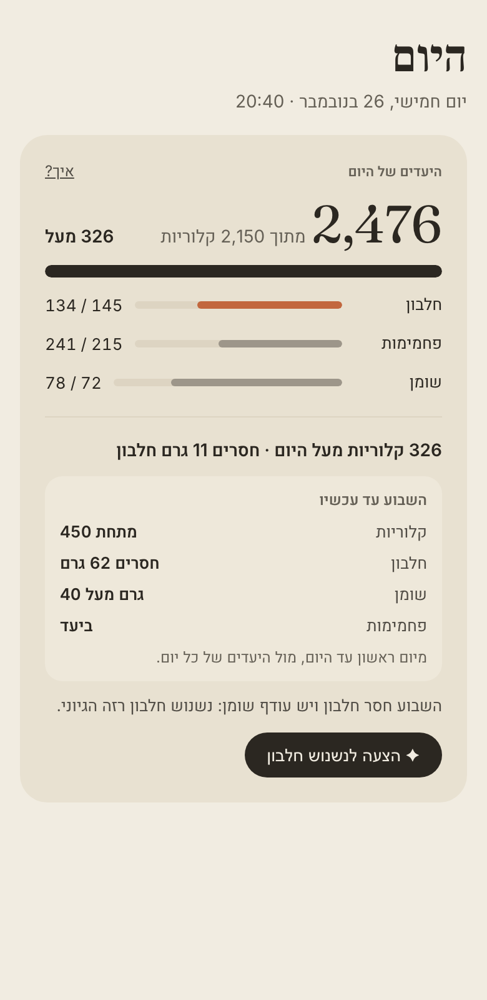 **26. Hebrew, the week** | 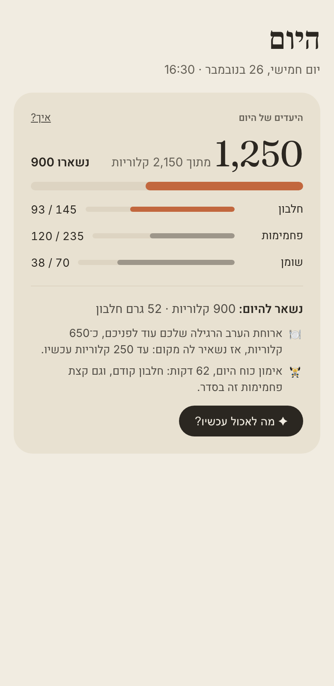 **27. Hebrew, dinner to come and training** |
| 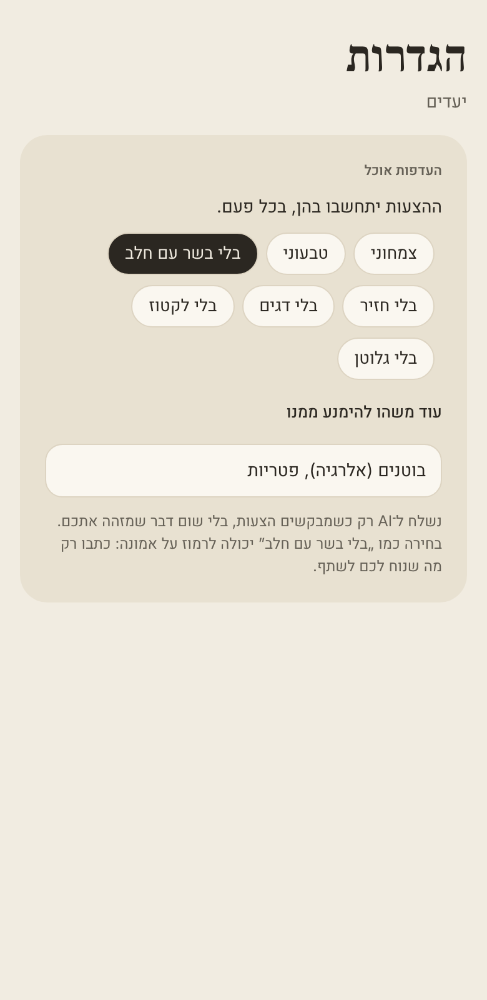 **28. Hebrew, food preferences** | |

As built (all four chosen), on the sample day:

| | |
| --- | --- |
| 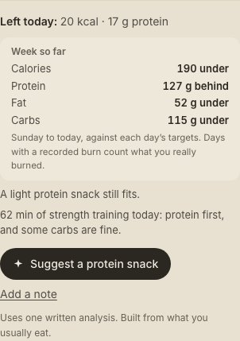 **29. The week's table and today's training** | 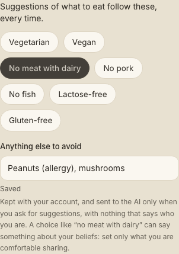 **30. Food preferences** |
| 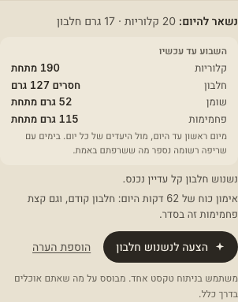 **31. Hebrew** | 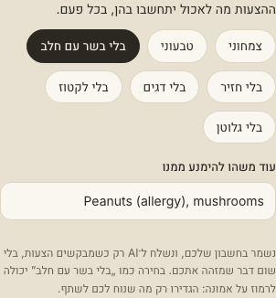 **32. Hebrew, food preferences** |

**Phase 1 of the precision design, as built** (2026-11-27,
[`../../meal-suggestions-precision.md`](../../meal-suggestions-precision.md)):

| | |
| --- | --- |
| 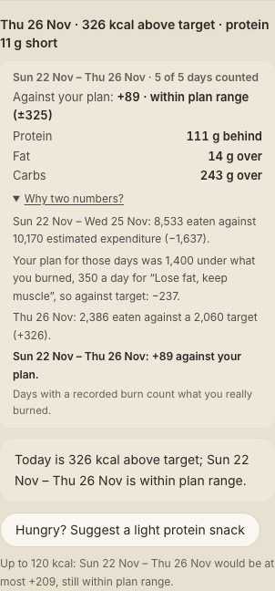 **33. The owner's Thursday: +89, within plan range, and why** | 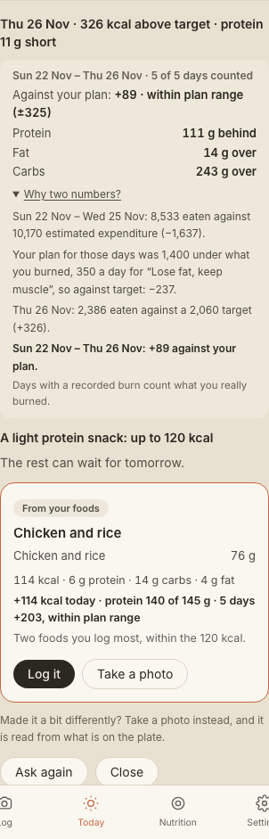 **34. The optional light snack, at most 120** |
| 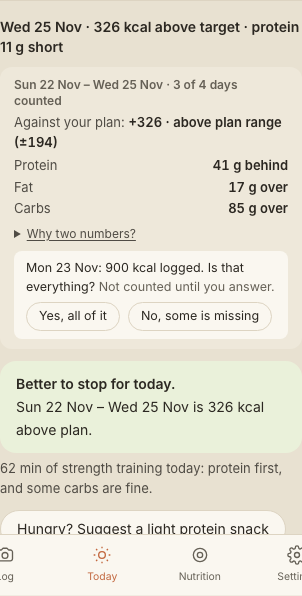 **35. A day possibly incomplete, not counted until answered** | 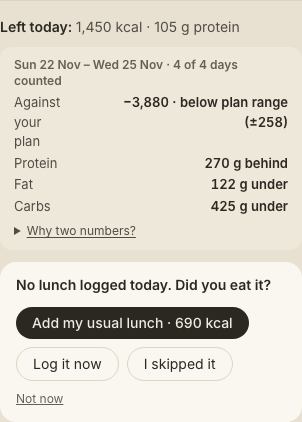 **36. Asked first: no lunch logged** |
| 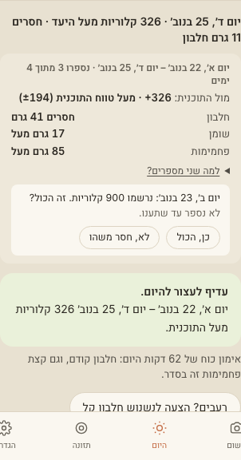 **37. Hebrew** | |
