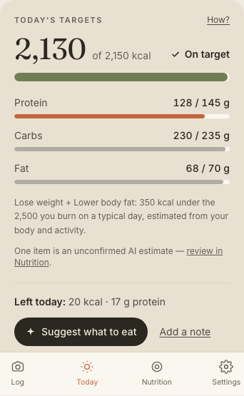
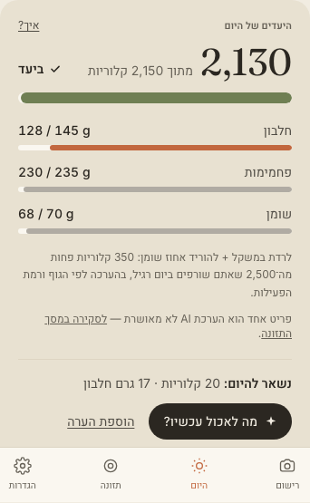

# Mock-ups — what to eat now

For [`../../meal-suggestions.md`](../../meal-suggestions.md). Drawn 2026-11-26
as HTML in the app's colours and fonts (`source/make.py` writes the pages,
`source/shoot.mjs` renders them at 390 px); not an interactive canvas.

| | |
| --- | --- |
|  **1. Ask** — the line under Today's targets, and the button |  **2. With a note** — "quick, no cooking…" |
|  **3. Thinking** |  **4. Three suggestions**, best fit first |
|  **5. Logged**, the targets move, Undo |  **8. Other states** |
|  **6. Hebrew, ask** |  **7. Hebrew, suggestions** |

**As built** (2026-11-26), on the sample day: on target for calories, 17 g of
protein short, so the suggestions are small. The test model's answers, not a
real model's. Each suggestion also has **Take a photo** (the owner's addition).

| | |
| --- | --- |
|  **9. Ask** |  **10. Suggestions** |
|  **11. Hebrew, ask** |  **12. Hebrew, suggestions** |
