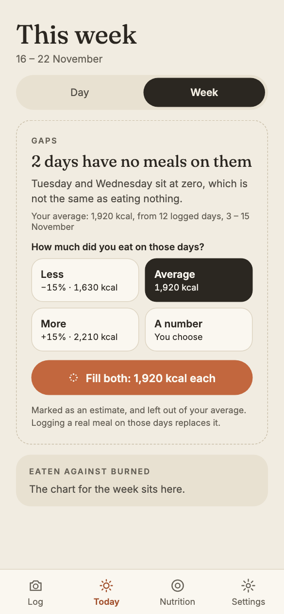
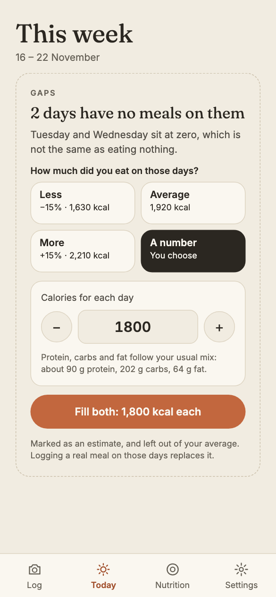
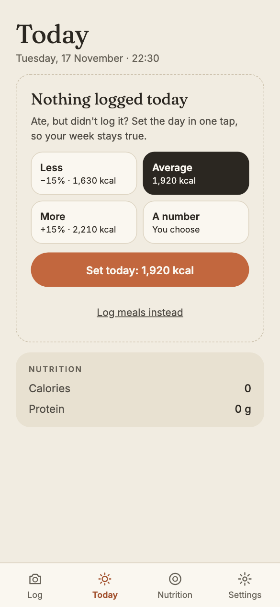
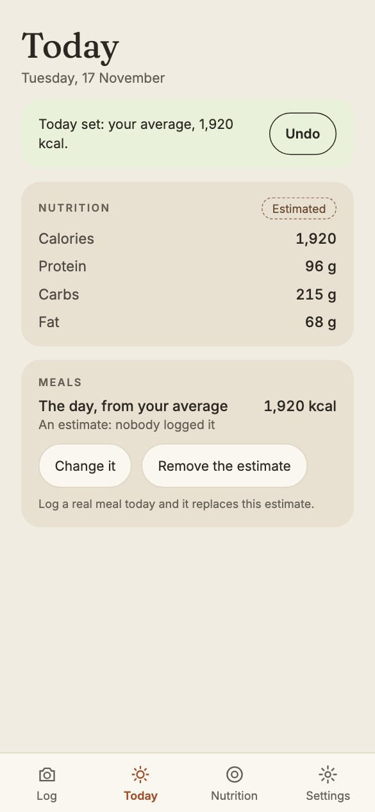
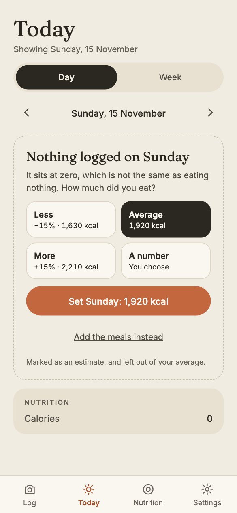
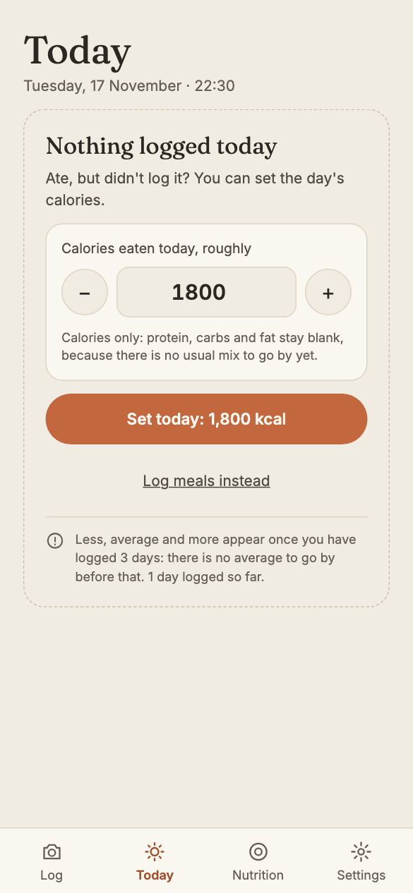
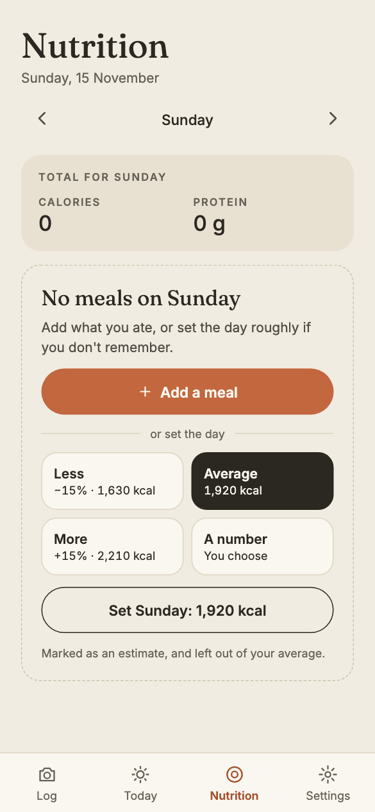
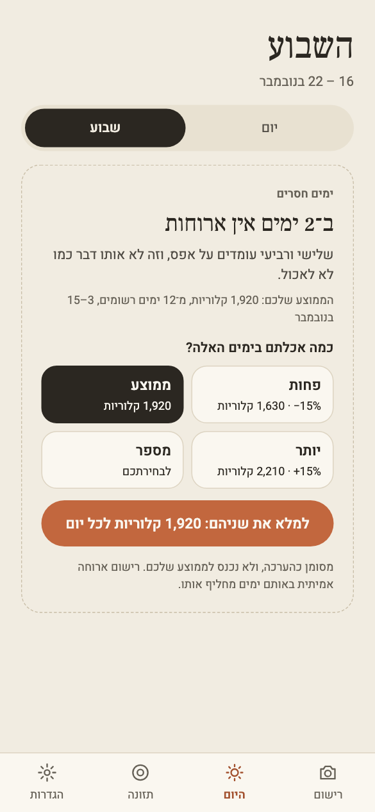
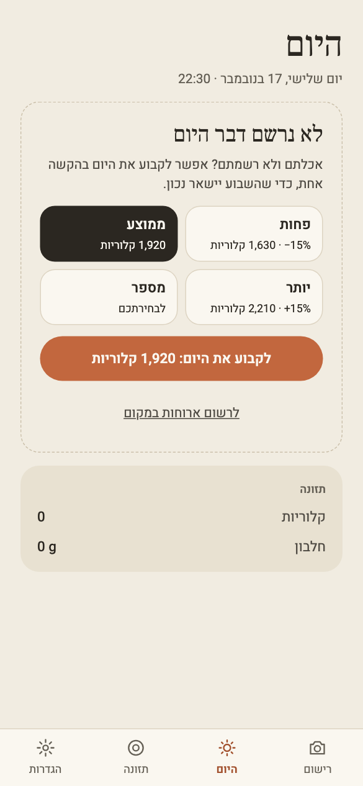
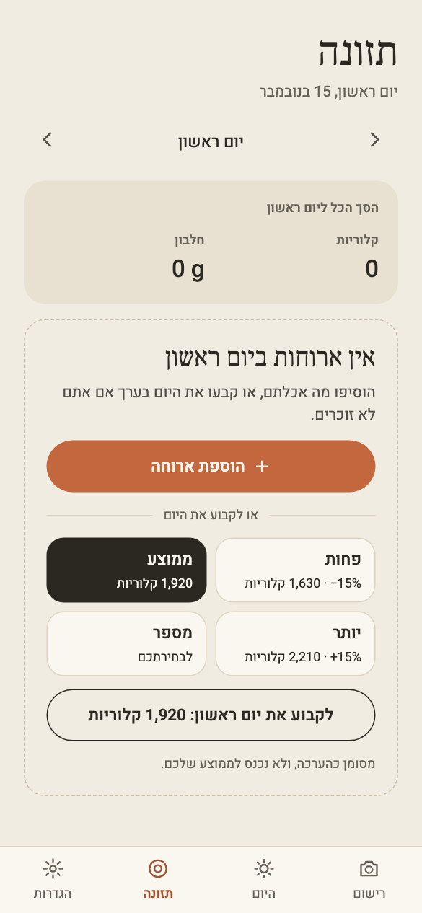

# Mock-ups — Quick-set a day

The design for [`quick-set-a-day.md`](../../quick-set-a-day.md). Built 2026-11-17.

- **Interactive canvas** (private to the owner, on claude.ai): https://claude.ai/artifact/5w4CL1YQNRHLUCAF78MR3n
- **Below:** each screen as an image, rendered from the canvas on 2026-11-17.
- **`source/`:** the canvas files themselves (`*.dc.html`, `canvas.json`). They open only
  inside the claude.ai design canvas, which supplies their runtime; the images are the
  way to read them anywhere else.

The mock-ups are the design, not the product: where the built app differs, the app and
its spec are what count.

## 1 · Week: fill missed days, with a choice

## 2 · Week: a number of your own

## 3 · Today, evening, nothing logged

## 4 · Today, after setting it

## 5 · Day tab, a past day with nothing logged

## 6 · Too little history: a number only

## 7 · Nutrition tab, a day with nothing logged

## 8 · עברית: השבוע, ימים חסרים

## 9 · עברית: היום, בערב

## 10 · עברית: תזונה, יום ריק

